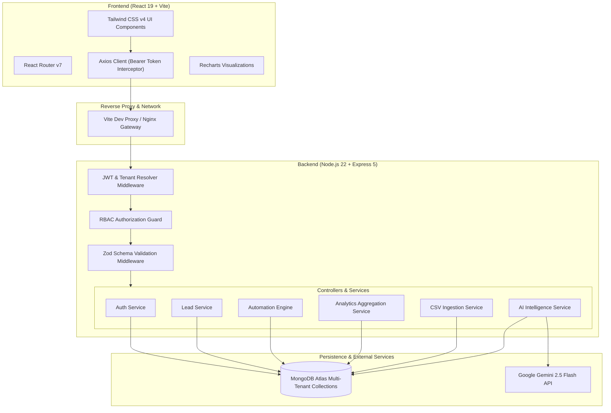
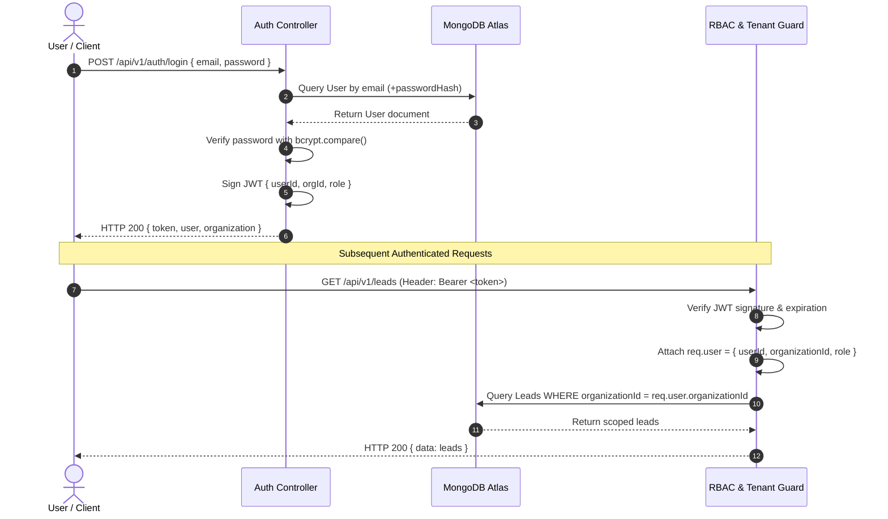
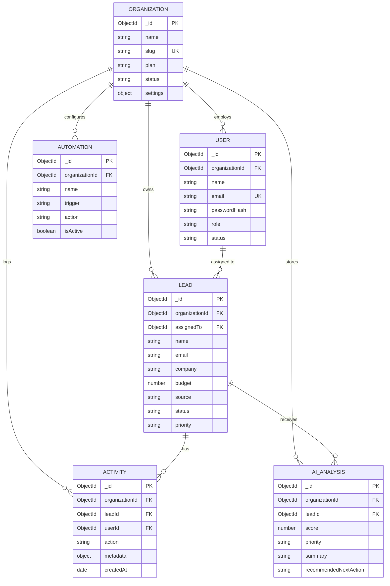

# OpsAI — Multi-Tenant AI Business Operations & Lead Intelligence Platform

[](https://nodejs.org/)
[](https://expressjs.com/)
[](https://react.dev/)
[](https://tailwindcss.com/)
[](https://www.mongodb.com/)
[](https://ai.google.dev/)
[](#testing)

OpsAI is an enterprise-grade, multi-tenant B2B SaaS platform engineered to streamline inbound lead qualification, sales workflow orchestration, and revenue intelligence. Powered by Google Gemini 2.5 Flash, OpsAI converts raw inquiries into actionable qualification assessments—scoring conversion probability, extracting key commercial signals, and drafting contextual outreach communications while maintaining strict multi-tenant data isolation and immutable audit logging.

---

## Table of Contents

- [Problem Statement](#problem-statement)
- [Key Features](#key-features)
- [Screenshots](#screenshots)
- [System Architecture](#system-architecture)
- [Technology Stack](#technology-stack)
- [Project Structure](#project-structure)
- [Authentication & RBAC](#authentication--rbac)
- [Multi-Tenancy Architecture](#multi-tenancy-architecture)
- [AI Intelligence Architecture](#ai-intelligence-architecture)
- [API Reference](#api-reference)
- [Database Schema & Indexes](#database-schema--indexes)
- [Getting Started](#getting-started)
  - [Prerequisites](#prerequisites)
  - [Environment Variables](#environment-variables)
  - [Installation & Running](#installation--running)
  - [Demo Data Seeding](#demo-data-seeding)
- [Testing](#testing)
- [Deployment Guidelines](#deployment-guidelines)
- [Future Roadmap](#future-roadmap)

---

## Problem Statement

Modern B2B revenue teams face severe friction during the top-of-funnel intake process:
1. **Slow Qualification Velocity:** Inbound prospects wait hours or days for SDR review, degrading conversion rates by up to 391% when response times exceed five minutes.
2. **Inconsistent Lead Scoring:** Reps manually evaluate deal sizes and technical requirements using subjective criteria rather than standardized qualification frameworks.
3. **Outreach Writer's Block:** Reps spend hours composing personalized outreach emails and follow-ups instead of holding customer conversations.
4. **Data Isolation Vulnerabilities:** Multi-tenant CRMs frequently suffer from leaky authorization boundaries where data between client organizations is exposed due to inadequate database filtering.

**OpsAI solves these challenges** by integrating Google Gemini 2.5 Flash directly into an isolated multi-tenant architecture, executing structured qualification assessments in seconds and enforcing cryptographic, database-level tenant separation.

---

## Key Features

### 🏢 Multi-Tenant Organization Isolation
- **Strict Logical Tenancy:** Every database query, mutation, and aggregation is scoped to the authenticated tenant's `organizationId`.
- **Zero Information Leakage:** Unauthorized cross-tenant resource requests return generic `404 Not Found` responses to prevent ID enumeration.

### 🤖 Gemini-Powered AI Lead Intelligence
- **Real-Time Qualification Scoring:** Produces deterministic lead scores (0–100), urgency levels (`LOW`, `MEDIUM`, `HIGH`), bulleted qualification factors, and recommended next steps.
- **Contextual Outreach Generator:** Synthesizes custom email drafts and short messages grounded in the prospect's explicit requirement, budget, and organizational tone settings (`professional`, `friendly`, `urgent`, `persuasive`).

### 🛡️ Role-Based Access Control (RBAC)
- **Granular Roles:** Enforces strict permission boundaries across `admin`, `manager`, and `sales` tiers.
- **Sales Rep Scoping:** Sales representatives are restricted to viewing and managing only their assigned accounts, while managers and admins access team-wide pipelines.

### 📋 Lead Lifecycle & Automated Audit Trail
- **Comprehensive Pipeline Management:** Supports standard lifecycle statuses (`new`, `contacted`, `qualified`, `proposal_sent`, `won`, `lost`).
- **Immutable Activity History:** Server-side event interceptors automatically record an audit timeline for every lead creation, assignment, status change, and AI evaluation.

### ⚡ Modular Automation Engine (V1)
- **Deterministic Event Rules:** Auto-escalates lead priority when an AI score exceeds 80/100 and schedules automated follow-up tasks when new leads remain uncontacted for 24 hours.
- **Pluggable Architecture:** Decoupled business rules ready to bind to background queue workers (e.g., BullMQ) in future milestones.

### 📥 High-Throughput CSV Bulk Ingestion
- **Multipart Stream Processing:** Parses and validates multi-lead CSV spreadsheets with row-level error reporting, ensuring partial file errors do not abort the entire batch.

### 📊 Real-Time Analytics & Aggregations
- **Native MongoDB Aggregations:** Calculates real-time conversion rates, status distributions, source breakdowns, and 30-day velocity timelines visualized with Recharts.

---

## Screenshots

| Dashboard & Real-Time Analytics | Lead Pipeline & AI Actions |
|:---:|:---:|
|  |  |
| *Live conversion metrics, lead velocity, and status distributions.* | *Lead pipeline table with quick filters, search, and assignees.* |

| AI Qualification & Scoring Modal | Admin User Management (RBAC) |
|:---:|:---:|
|  |  |
| *Structured Gemini scoring, rationale breakdown, and outreach drafting.* | *Organization user invitation, role assignment, and access control.* |

---

## System Architecture



---

## Technology Stack

| Layer | Technology | Version | Purpose |
|---|---|---|---|
| **Frontend Runtime** | React | `^19.3.0` | UI component tree with concurrent rendering |
| **Build & Tooling** | Vite | `^8.3.0` | Lightning-fast HMR and production bundling |
| **Styling** | Tailwind CSS | `^4.3.3` | Modern CSS-first utility styling |
| **Routing** | React Router | `^7.18.4` | Client-side routing, protected routes, and navigation |
| **Data Visualization** | Recharts | `^3.10.1` | Declarative SVG charting for conversion metrics |
| **Icons** | Lucide React | `^1.48.0` | Accessible SVG icon suite |
| **HTTP Client** | Axios | `^1.20.0` | Promise-based HTTP client with auth interceptors |
| **Backend Runtime** | Node.js | `>= 22.0.0` | Non-blocking asynchronous JavaScript runtime |
| **Web Framework** | Express | `^5.2.1` | Robust HTTP router with native Promise error handling |
| **Database** | MongoDB Atlas | `>= 8.0` | Scalable document store with aggregation pipelines |
| **ODM** | Mongoose | `^9.10.2` | Schema enforcement, validation hooks, and compound indexes |
| **AI LLM Engine** | Google GenAI SDK | `^2.24.0` | Official SDK calling Gemini 2.5 Flash with structured schema |
| **Security & Auth** | JSON Web Tokens & Bcrypt | `jwt 9.0`, `bcrypt 6.0` | Stateless token authentication & salted password hashing |
| **Schema Validation** | Zod | `^4.6.5` | Type-safe runtime schema parsing and error boundaries |
| **File Parsing** | PapaParse & Multer | `papa 5.7`, `multer 2.4` | Multipart CSV stream ingestion and parsing |
| **Testing** | Node.js Native Test Runner | `node:test` | Native test suite execution with 0 external dependencies |

---

## Project Structure

```text
ai-business-operations-saas/
├── client/                          # React 19 Frontend Application
│   ├── public/                      # Static assets
│   ├── src/
│   │   ├── api/                     # Axios instance & endpoint service functions
│   │   ├── components/              # Shared UI (Navbar, Sidebar, Modals, Tables)
│   │   ├── context/                 # AuthContext & organization state providers
│   │   ├── pages/                   # Route views (Dashboard, Leads, Admin, Login, Register)
│   │   ├── App.jsx                  # Main routing and authenticated route guards
│   │   ├── main.jsx                 # Client entry point
│   │   └── index.css                # Tailwind CSS v4 directives
│   ├── package.json
│   └── vite.config.js               # Dev server port 5173 with /api proxy to port 5000
│
├── server/                          # Express 5 Backend REST API
│   ├── docs/                        # API checklists and documentation
│   ├── postman/                     # Ready-to-import Postman Collection v2.1
│   ├── scripts/                     # Operational scripts
│   │   ├── seed.js                  # Multi-tenant realistic development seed script
│   │   └── test-real-user-flow.js   # 15-step real-user end-to-end integration script
│   ├── src/
│   │   ├── config/                  # Environment validation & DB connection logic
│   │   ├── controllers/             # Express request/response handlers
│   │   ├── middleware/              # Auth, RBAC, Zod validation, error handling
│   │   ├── models/                  # Mongoose models (Org, User, Lead, Activity, AI, Automation)
│   │   ├── routes/                  # Express API route declarations
│   │   ├── services/                # Encapsulated business logic (Auth, Lead, AI, Analytics)
│   │   ├── app.js                   # Express application setup and middleware pipeline
│   │   └── server.js                # HTTP listener and graceful shutdown coordinators
│   ├── tests/                       # 8 native automated test suites (49 test cases)
│   ├── package.json
│   └── .env.example                 # Backend environment variable template
│
└── package.json                     # Root orchestrator (concurrent dev & seed shortcuts)
```

---

## Authentication & RBAC

OpsAI utilizes stateless JSON Web Tokens (JWT) signed with HMAC SHA-256 containing the user ID, organization ID, and role.



### Role Matrix

| Action / Resource | Admin | Manager | Sales Rep |
|---|:---:|:---:|:---:|
| **View Organization Leads** | All Leads | All Leads | Assigned Leads Only |
| **Create & Update Leads** | ✅ | ✅ | ✅ |
| **Delete Leads** | ✅ | ✅ | ❌ (403 Forbidden) |
| **Run AI Scoring & Follow-ups** | ✅ | ✅ | ✅ |
| **Bulk Import Leads (CSV)** | ✅ | ✅ | ✅ |
| **View Analytics Dashboard** | Full Org Scope | Full Org Scope | Full Org Scope |
| **Manage Team Users & Roles** | ✅ | ❌ (403 Forbidden) | ❌ (403 Forbidden) |
| **Modify Organization Settings** | ✅ | ❌ (403 Forbidden) | ❌ (403 Forbidden) |

---

## Multi-Tenancy Architecture

OpsAI enforces a **Pooled Multi-Tenant Data Architecture** utilizing tenant-scoped logical isolation:

1. **Mandatory Tenant Discriminator:** Every tenant entity (`User`, `Lead`, `Activity`, `AIAnalysis`, `Automation`) strictly defines a non-nullable `organizationId` reference.
2. **Index-Backed Compound Partitioning:**
   ```javascript
   leadSchema.index({ organizationId: 1, status: 1, priority: 1, createdAt: -1 });
   leadSchema.index({ organizationId: 1, assignedTo: 1, status: 1 });
   ```
3. **Fail-Safe Mutation Scoping:** All database update and delete queries enforce the authenticated tenant's identity:
   ```javascript
   const lead = await Lead.findOne({ _id: leadId, organizationId: req.user.organizationId });
   if (!lead) throw new NotFoundError('Lead not found');
   ```
4. **Information Disclosure Prevention:** Attempting to read or mutate another tenant's entity produces an HTTP 404 rather than an HTTP 403, preventing resource existence discovery.

---

## AI Intelligence Architecture

AI capabilities are orchestrated through `@google/genai` utilizing the **Gemini 2.5 Flash** model for sub-second qualification assessments.

### 1. Structured Lead Scoring (`POST /api/v1/ai/analyze/:leadId`)
Gemini evaluates the prospect's company, budget, source, and requirements against a strict JSON schema:
```json
{
  "score": 85,
  "priority": "HIGH",
  "summary": "High commercial alignment for cloud ERP migration with allocated $75k budget.",
  "reasons": [
    "Budget explicitly defined within target deal size ($75,000).",
    "Verified corporate domain contact with urgent timeline.",
    "Technical requirement directly maps to core integration competencies."
  ],
  "recommendedNextAction": "Schedule executive discovery call within 24 hours to review migration architecture."
}
```

### 2. Contextual Outreach Drafting (`POST /api/v1/ai/follow-up/:leadId`)
Generates personalized communications adapted to tenant-configured tone settings:
* **Email Messages:** Structured with high-converting subject lines and personalized body copy addressing explicit pain points.
* **Short Messages:** Concise SMS / LinkedIn InMail outreach under 160 characters designed for immediate mobile response.

---

## API Reference

All application endpoints are versioned under `/api/v1`:

### Authentication & Account
| Method | Endpoint | Access | Description |
|---|---|---|---|
| `POST` | `/api/v1/auth/register` | Public | Register new tenant organization and primary admin user |
| `POST` | `/api/v1/auth/login` | Public | Authenticate user and receive Bearer JWT |
| `GET` | `/api/v1/auth/me` | Authenticated | Retrieve authenticated user profile and organization context |

### Lead Management
| Method | Endpoint | Access | Description |
|---|---|---|---|
| `GET` | `/api/v1/leads` | Authenticated | Paginated, filtered, and searchable lead list |
| `POST` | `/api/v1/leads` | Authenticated | Create a new lead (auto-logs audit activity) |
| `GET` | `/api/v1/leads/:id` | Authenticated | Get detailed lead record with populated assignee |
| `PUT` | `/api/v1/leads/:id` | Authenticated | Update lead attributes, status, or assignment |
| `DELETE` | `/api/v1/leads/:id` | Admin / Manager | Permanently remove a lead record |
| `POST` | `/api/v1/leads/import/csv` | Authenticated | Multipart CSV bulk upload with row-level error reporting |
| `GET` | `/api/v1/leads/:id/activities` | Authenticated | Retrieve complete chronological audit timeline |

### AI Intelligence
| Method | Endpoint | Access | Description |
|---|---|---|---|
| `POST` | `/api/v1/ai/analyze/:leadId` | Authenticated | Generate structured qualification score and action plan |
| `GET` | `/api/v1/ai/lead/:leadId` | Authenticated | Retrieve most recent persisted AI analysis |
| `POST` | `/api/v1/ai/follow-up/:leadId`| Authenticated | Generate tailored email or short message outreach |

### Analytics & Reporting
| Method | Endpoint | Access | Description |
|---|---|---|---|
| `GET` | `/api/v1/analytics/overview` | Authenticated | Aggregated conversion rates, distributions, and 30-day timeline |

### Admin User Management
| Method | Endpoint | Access | Description |
|---|---|---|---|
| `GET` | `/api/v1/users` | Admin Only | List all team members within the organization |
| `POST` | `/api/v1/users` | Admin Only | Add or invite a new user with specific role |
| `PUT` | `/api/v1/users/:id/role` | Admin Only | Update team member role (`admin`, `manager`, `sales`) |
| `PUT` | `/api/v1/users/:id/status` | Admin Only | Activate or suspend a user account |

### System Health
| Method | Endpoint | Access | Description |
|---|---|---|---|
| `GET` | `/api/health` | Public | Node.js uptime, memory RSS, and MongoDB connection status |

---

## Database Schema & Indexes



---

## Getting Started

### Prerequisites
* **Node.js:** `v20.x` or `v22.x`
* **Package Manager:** `npm` (included with Node.js)
* **Database:** Active MongoDB instance (local or MongoDB Atlas connection string)
* **AI API Key:** [Google AI Studio Gemini API Key](https://aistudio.google.com/)

---

### Environment Variables

#### Backend Configuration (`server/.env`)
Create `server/.env` with the following variables:
```ini
# Application Environment
NODE_ENV=development
PORT=5000

# Database Connectivity
MONGO_URI=mongodb+srv://<username>:<password>@cluster.mongodb.net/opsai_dev?retryWrites=true&w=majority

# Cryptographic Secrets
JWT_SECRET=your_super_secret_jwt_key_min_32_characters_long
JWT_EXPIRES_IN=7d

# Google Gemini Intelligence
GEMINI_API_KEY=AIzaSyYourGeminiApiKeyHere

# Cross-Origin Resource Sharing
CLIENT_URL=http://localhost:5173
```

#### Frontend Configuration (`client/.env`)
Create `client/.env` (optional in development due to Vite proxy):
```ini
VITE_API_URL=/api/v1
```

---

### Installation & Running

#### 1. Clone & Install Dependencies
```powershell
git clone https://github.com/your-org/ai-business-operations-saas.git
cd ai-business-operations-saas

# Install root dependencies
npm install

# Install server and client dependencies
npm --prefix server install
npm --prefix client install
```

#### 2. Run Both Services Concurrently
```powershell
npm run dev
```
* **Frontend:** [http://localhost:5173](http://localhost:5173)
* **Backend API:** [http://localhost:5000](http://localhost:5000)
* **API Health Check:** [http://localhost:5000/api/health](http://localhost:5000/api/health)

*(Optional) Run services in separate terminal windows:*
```powershell
# Terminal 1: Backend API
npm --prefix server run dev

# Terminal 2: Frontend Client
npm --prefix client run dev
```

---

### Demo Data Seeding

OpsAI includes an idempotent, development-only seed script that generates two completely isolated demo tenants with 104 realistic leads, role-based users, AI analyses, and 30-day activity timelines:

```powershell
# Seed realistic demo data
npm run seed

# To remove demo data without re-creating
npm run seed:clean
```

#### Demo Credentials (Password: `DemoPassword123!`)

| Organization | Role | Email | Scope |
|---|---|---|---|
| **Apex Innovations Ltd** | Admin | `admin@apex.dev` | Complete admin & user management |
| **Apex Innovations Ltd** | Manager | `manager@apex.dev` | Team leads oversight & assignment |
| **Apex Innovations Ltd** | Sales | `sales.alex@apex.dev` | Individual assigned leads |
| **Nimbus Cloud Solutions**| Admin | `admin@nimbus.dev` | Tenant-isolated admin operations |
| **Nimbus Cloud Solutions**| Sales | `sales.sam@nimbus.dev` | Tenant-isolated sales operations |

---

## Testing

OpsAI utilizes the **Node.js 22 Native Test Runner (`node:test`)** for zero-dependency, ultra-fast test execution.

```powershell
# Run the complete test suite (8 suites, 49 tests)
npm test

# Run a specific test suite
node --test server/tests/01-auth.test.js
node --test server/tests/05-organization-isolation.test.js

# Run the 15-step real-user end-to-end integration simulation
node server/scripts/test-real-user-flow.js
```

### Test Suite Coverage
* **Suite 1: Authentication Behavior:** Registration, duplicate email rejection, password verification, suspended accounts, and session validation (`/auth/me`).
* **Suite 2: Role-Based Authorization:** Permission enforcement across Admin, Manager, and Sales roles.
* **Suite 3: Lead CRUD & Audit Trail:** Creation, lookup, pagination, status transitions, and automated activity logging.
* **Suite 4: Request Validation:** Zod schema boundaries, ObjectId validation, and malformed payload handling.
* **Suite 5: Multi-Tenant Data Isolation:** Read, list, update, delete, and user management cross-tenant leakage prevention.
* **Suite 6: AI Intelligence Endpoints:** Gemini lead scoring, follow-up generation, and cross-tenant AI execution guards.
* **Suite 7: CSV Lead Bulk Import:** Stream parsing, validation failure isolation, and file format enforcement.
* **Suite 8: Analytics Aggregation:** Real-time conversion rate calculations and multi-tenant metric partitioning.

---

## Deployment Guidelines

### Production Build
```powershell
# Build optimized static frontend assets to client/dist/
npm run build:client

# Start production server
npm --prefix server start
```

### Containerization (Docker Example)
```dockerfile
# Multi-stage production Dockerfile
FROM node:22-alpine AS builder
WORKDIR /app
COPY client/package*.json client/
RUN npm --prefix client ci
COPY client/ client/
RUN npm --prefix client run build

FROM node:22-alpine AS runner
WORKDIR /app
ENV NODE_ENV=production
COPY server/package*.json server/
RUN npm --prefix server ci --omit=dev
COPY server/ server/
COPY --from=builder /app/client/dist /app/server/public
EXPOSE 5000
CMD ["node", "server/src/server.js"]
```

### Security Checklist for Production
- [ ] Set `NODE_ENV=production` in production environments.
- [ ] Provide a high-entropy `JWT_SECRET` (at least 64 random alphanumeric characters).
- [ ] Enforce strict CORS whitelist matching the production frontend origin domain.
- [ ] Configure MongoDB Atlas Network Access with VPC peering or dedicated static IP whitelisting.
- [ ] Enable TLS/SSL termination with automatic HTTP-to-HTTPS redirection via Cloudflare or Nginx reverse proxy.
- [ ] Configure rate limiting headers (`express-rate-limit`) on public authentication and AI endpoints.

---

## Future Roadmap

- [ ] **Distributed Job Queues:** Integrate Redis & BullMQ for asynchronous batch AI lead processing and email delivery.
- [ ] **Real-Time Collaboration:** WebSocket integration for live lead status changes and user activity streams.
- [ ] **External CRM Integrations:** Two-way synchronization with Salesforce, HubSpot, and Pipedrive.
- [ ] **Custom AI Prompt Studio:** Enable tenant administrators to customize evaluation rubrics and scoring weights directly from the dashboard.
- [ ] **Multi-Factor Authentication (MFA):** Authenticator app (TOTP) enforcement for administrative tiers.

---

## License

This project is licensed under the MIT License — see the [LICENSE](LICENSE) file for details.
